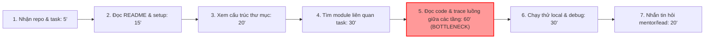
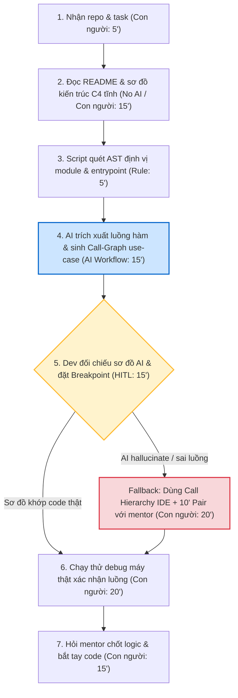

# Báo cáo nhóm — Day 02 Discovery & Problem Framing

> Bản chung của nhóm, viết trên repo do nhóm trưởng fork. Không copy file này sang repo cá nhân.
> Template chi tiết và prompt mẫu: [docs/01-worksheet.md](../../docs/01-worksheet.md). Bài mẫu: [docs/02-deliverable-example.md](../../docs/02-deliverable-example.md).

## 1. Thông tin nhóm

- Tên nhóm: Siuu
- Thành viên: xem `TEAM.md`
- Candidate problem được chọn (1 câu): Khi tiếp nhận dự án phần mềm mới, developer mới muốn hiểu nhanh cấu trúc mã nguồn và luồng xử lý chính của module cần sửa, để bắt đầu thực hiện task đầu tiên mà không làm gián đoạn công việc của mentor/đồng nghiệp.
- Quyết định cuối: Go (phạm vi pilot nhỏ)

---

## 2. Hội tụ nhóm (CP3)

### 2.1. Pitch

|   # | Người đưa ra     | Candidate (Job Story ngắn)                                                                                                  | Actor                   | Bottleneck                                                                     | Câu hỏi phản biện nhận được (ai hỏi)                                                                                                                   |
| --: | ---------------- | --------------------------------------------------------------------------------------------------------------------------- | ----------------------- | ------------------------------------------------------------------------------ | ------------------------------------------------------------------------------------------------------------------------------------------------------ |
|   1 | Lê Nhật Linh     | Khi tiếp nhận dự án mới, dev mới muốn hiểu cấu trúc và luồng xử lý code, để làm task chính xác.                             | Developer mới           | Đọc code và trace luồng gọi hàm giữa các tầng (60' trên tổng 180' onboarding). | "AI chỉ giảm bước 5 được 35', vậy 55' còn lại để đạt 180' → 90' giảm ở đâu?" (Hoàng Gia Khiêm hỏi)                                                     |
|   2 | Lê Nhật Linh     | Khi nhận task chưa rõ ràng, dev muốn hiểu đúng tiêu chí hoàn thành, để tránh bị reject khi review code.                     | Developer, thành viên   | Chờ phản hồi giải thích yêu cầu từ người giao task (60' chờ trên tổng 210').   | "Vấn đề này do người giao thiếu template hay do dev chưa chủ động research?" (Đặng Thanh Hải hỏi)                                                      |
|   3 | Lê Nhật Linh     | Khi đến kỳ báo cáo tuần, nhóm trưởng muốn tổng hợp tiến độ, để nộp báo cáo đúng hạn.                                        | Trưởng nhóm, thành viên | Thu thập và nhắc các thành viên gửi cập nhật (20' trên tổng 70').              | "Jira và GitHub Projects đã có dashboard số liệu, tại sao khâu này vẫn mất 70 phút?" (Nguyễn Quốc Việt hỏi)                                            |
|   4 | Đặng Thanh Hải   | Khi tới thứ Sáu, Content Lead muốn lên lịch phân phối 10-12 bài viết lên Facebook, LinkedIn, Blog, để không đăng thủ công.  | Content Lead            | Copy/paste và định dạng từng kênh (45' trên tổng 95').                         | "Buffer và Hootsuite đã hỗ trợ lên lịch đa kênh bằng Rule/API, AI tạo thêm giá trị gì ở đây?" (Nguyễn Quốc Việt hỏi)                                    |
|   5 | Đặng Thanh Hải   | Khi nhận bài blog 2.000 từ từ agency, Content Lead muốn soát lỗi diễn đạt và chuẩn SEO, để duyệt bài đúng hạn.              | Content Lead            | Đọc kỹ và viết nhận xét chi tiết (55' trên tổng 60'/bài).                      | "Tại sao không bắt agency tự chạy checklist format/chính tả trước khi nộp mà Lead phải tốn 60' sửa thay? Lỗi quy trình hay cần AI?" (Lê Nhật Linh hỏi) |
|   6 | Đặng Thanh Hải   | Khi cần lên idea bài viết mới, Content Lead muốn gom nhóm thắc mắc của độc giả, để không bỏ sót pain point.                 | Content Lead            | Lọc thủ công qua nhiều luồng bình luận/chat (35' trên tổng 45').               | "Nếu số lượng comment ít (vài chục cái), dùng bảng tính Google Sheets filter có nhanh hơn không?" (Hoàng Gia Khiêm hỏi)                                |
|   7 | Hoàng Gia Khiêm  | Khi đồng nghiệp hỏi câu trùng lặp (quy trình, giá, hạn), người phụ trách muốn có câu trả lời chuẩn, để không gõ lại từ đầu. | Người trực tiếp trả lời | Tìm lại thông tin và gõ lại câu trả lời (3.5' trên tổng 4'/câu).               | "Đã có quick reply/snippet trên Zalo/Slack, sao cần AI nháp lại từng câu?" (Nguyễn Quốc Việt hỏi)                                                     |
|   8 | Hoàng Gia Khiêm  | Khi họp xong, người ghi biên bản muốn có ngay tóm tắt việc và hạn chót, để không mất công nghe lại ghi âm.                  | Người ghi biên bản      | Nghe lại ghi âm để không sót ý (12' trên tổng 30'/buổi).                       | "Ghi âm cuộc họp đưa lên AI có vi phạm bảo mật thông tin nội bộ của nhóm không?" (Lê Nhật Linh hỏi)                                                    |
|   9 | Hoàng Gia Khiêm  | Khi chuẩn bị gửi tài liệu cho sếp duyệt, nhân viên muốn tự kiểm tra lỗi format và số liệu, để giảm số lần bị trả về.        | Nhân viên làm văn bản   | Soát thủ công từng trang theo quy định (15'/bản).                              | "Tiêu chí bắt lỗi của sếp có định lượng thành rule rõ ràng được không hay phụ thuộc cảm tính?" (Đặng Thanh Hải hỏi)                                    |
|  10 | Nguyễn Quốc Việt | Khi nhiều môn giao bài với hạn khác nhau, sinh viên muốn theo dõi hạn nộp, để hoàn thành đúng hạn.                          | Sinh viên học nhiều môn | Tổng hợp và nhớ hạn từ nhiều nền tảng (10–15'/tuần).                           | "Google Calendar và tính năng nhắc hẹn của LMS đã giải quyết tự động việc này rồi, sao cần AI?" (Lê Nhật Linh hỏi)                                     |
|  11 | Nguyễn Quốc Việt | Khi làm bài tập nhóm 3–5 người, thành viên muốn chia việc và theo dõi tiến độ, để hoàn thành bài hiệu quả.                  | Thành viên nhóm bài tập | Thu thập cập nhật tiến độ và ghép các phần (1–2h/dự án).                       | "Dùng bảng Kanban Trello/Notion kết hợp họp nhanh 10' có nhanh hơn là đợi AI điều phối không?" (Đặng Thanh Hải hỏi)                                    |
|  12 | Nguyễn Quốc Việt | Khi làm bài lập trình gặp lỗi, sinh viên muốn hiểu nguyên nhân và sửa lỗi, để hoàn thành bài mà vẫn học được cách debug.    | Sinh viên học lập trình | Tìm hiểu nguyên nhân gốc của lỗi khó (20–60'/lỗi).                             | "Làm sao đảm bảo AI giải thích bản chất lỗi để sinh viên hiểu bài chứ không chỉ đưa đáp án chép vẹt?" (Hoàng Gia Khiêm hỏi)                            |

### 2.2. Cluster

| Cluster                                               | Các candidate                                                                                                                                                                | Pattern chung                                                                                                                                      |
| ----------------------------------------------------- | ---------------------------------------------------------------------------------------------------------------------------------------------------------------------------- | -------------------------------------------------------------------------------------------------------------------------------------------------- |
| A — Đọc hiểu Kỹ thuật & Gỡ lỗi Mã nguồn               | #1 (Tìm hiểu codebase dự án mới), #12 (Gỡ lỗi lập trình sinh viên)                                                                                                           | Người mới/sinh viên tiếp cận hệ thống mã nguồn hoặc lỗi phức tạp, tài liệu/thông báo lỗi khó hiểu, tốn 30–60 phút đọc code và tìm nguyên nhân gốc. |
| B — Kiểm duyệt & Soát lỗi Nội dung / Văn bản          | #5 (Review bài blog agency), #9 (Soát lỗi tài liệu trước khi duyệt)                                                                                                          | Người kiểm duyệt phải đọc lượng lớn văn bản để bắt lỗi ngữ pháp, format, chính tả và chuẩn quy định; tốn nhiều thời gian đọc rà soát thủ công.     |
| C — Tổng hợp Thông tin, Điều phối & Giao tiếp lặp lại | #2 (Task không rõ), #3 (Báo cáo tuần), #4 (Lên lịch đa kênh), #6 (Gom feedback), #7 (Câu hỏi trùng lặp), #8 (Biên bản họp), #10 (Theo dõi hạn nộp), #11 (Điều phối bài nhóm) | Dữ liệu bị phân tán ở nhiều kênh (chat, tool, họp), thao tác thu thập/phản hồi thủ công lặp lại nhiều lần gây gián đoạn công việc chính.           |

### 2.3. Opportunity Solution Tree rút gọn

Gốc là **1 outcome**. Nhánh là **opportunity** (nhu cầu, pain), không phải tính năng hay công cụ.

```text
OUTCOME: Giảm thời gian Developer mới cần để bắt đầu hoàn thành task đầu tiên trong dự án từ 180 phút xuống ≤ 90 phút
├── Opportunity A: Khó xác định luồng xử lý chính và điểm chạm giữa các tầng (Route → Controller → Service → Database) trong codebase lớn
├── Opportunity B: Tài liệu dự án (README, Wiki) sơ sài, thiếu sơ đồ luồng dữ liệu hoặc đã lỗi thời so với code thực tế
└── Opportunity C: Mentor và đồng nghiệp bận rộn, thời gian chờ phản hồi hướng dẫn kéo dài gây nghẽn tiến độ làm task
```

Những ý đã gạch bỏ vì là solution đội lốt opportunity:

- ✗ _"Xây dựng Chatbot AI trả lời tự động mọi thắc mắc về mã nguồn"_ (Solution trá hình đội lốt, gạch bỏ)
- ✗ _"Plugin tự động sinh tài liệu code bằng AI Agent"_ (Solution trá hình đội lốt, gạch bỏ)
- ✗ _"Dashboard trực quan hóa kiến trúc codebase"_ (Solution trá hình đội lốt, gạch bỏ)

### 2.4. Chấm điểm shortlist (1–5)

| Candidate                                              | Actor rõ | Quy trình rõ | Pain có bằng chứng | Impact đo được | Vừa sức lab | So sánh được No AI/Rule/Workflow/Agent | Nhóm hiểu domain |   Tổng |
| ------------------------------------------------------ | -------: | -----------: | -----------------: | -------------: | ----------: | -------------------------------------: | ---------------: | -----: |
| 1. Tìm hiểu codebase mới khi tiếp nhận dự án (Linh #1) |        5 |            5 |                  5 |              5 |           5 |                                      5 |                5 | **35** |
| 2. Trợ lý gỡ lỗi lập trình sinh viên (Việt #3)         |        4 |            4 |                  5 |              4 |           4 |                                      4 |                5 | **30** |
| 3. Review/soát lỗi bài viết blog agency (Hải #2)       |        4 |            5 |                  4 |              4 |           4 |                                      3 |                4 | **28** |

**Candidate được chọn:**
`Tìm hiểu codebase mới khi tiếp nhận dự án (Candidate #1 của Lê Nhật Linh).`

**Vì sao chọn:**

1. **Actor rõ & đo được:** Developer mới / thực tập sinh IT; bottleneck trace code giữa các tầng mất 60' trên tổng 180' onboarding task đầu.
2. **Hiểu sâu domain:** Cả 4 thành viên đều học CNTT/lập trình, có sẵn số liệu bấm giờ thật từ đồ án để kiểm chứng ngay.
3. **Đất diễn 4 mức can thiệp:** So sánh rành mạch No AI (README + C4 model), Rule (linter/grep), Workflow (LLM sinh call-graph theo use-case + dev tự debug xác minh) và Agent (tự duyệt toàn bộ repo).

**Vì sao loại các candidate còn lại:**

- **Loại bài Gỡ lỗi code (Việt):** Phạm vi lỗi lập trình quá rộng; rủi ro sinh viên ỷ lại chép code sửa sẵn thay vì học bản chất lỗi, ranh giới an toàn (boundary) khó kiểm soát trong 1 buổi lab.
- **Loại bài Review blog (Hải):** 70% vấn đề giải quyết được bằng Rule (bắt agency điền checklist nghiệm thu trước khi nộp); tiêu chuẩn "brand voice" định tính, khó đo lường chính xác.

**Xử lý bất đồng (nếu có):**

- Cả 4 thành viên thống nhất chọn bài Codebase vì có baseline đo lường bằng phút cụ thể (180' → 90') và khớp năng lực kỹ thuật của cả nhóm.

---

## 3. Kiểm chứng + research giải pháp đã có (CP4)

### 3.1. Assumption Map

|   # | Giả định                                                                                                                                              | Loại (Value / Usability / Feasibility / Viability) | Quan trọng (1–5) | Đã có bằng chứng (1–5) | Kiểm chứng trước? |
| --: | ----------------------------------------------------------------------------------------------------------------------------------------------------- | -------------------------------------------------- | ---------------: | ---------------------: | ----------------- |
|   1 | Dev mới mất nhiều thời gian nhất ở việc lần theo luồng code giữa các tầng (Route → Controller → Service → DB) chứ không phải khâu cài đặt môi trường. | Value                                              |                5 |                      4 | **Có**            |
|   2 | Dev mới sẽ tin tưởng và sử dụng sơ đồ luồng tương tác hàm do AI gợi ý thay vì đọc code lần mò thủ công.                                               | Usability                                          |                4 |                      2 | **Có**            |
|   3 | AI có khả năng đọc hiểu cấu trúc đa file và trace chính xác luồng hàm mà không bịa ra các file/function ảo (hallucination).                           | Feasibility                                        |                5 |                      2 | **Có**            |
|   4 | Chuẩn hóa tài liệu README và sơ đồ kiến trúc tĩnh (No AI) không đủ để giải thích các use-case nghiệp vụ động theo từng task cụ thể.                   | Value                                              |                4 |                      3 | **Có**            |
|   5 | Dự án/công ty cho phép tải cấu trúc mã nguồn (hoặc chữ ký hàm) lên các mô hình AI để hỗ trợ lập trình viên.                                           | Viability                                          |                3 |                      4 | Không             |

Giả định nhóm kiểm chứng trong buổi này: **Giả định #1, #2 và #3.**

### 3.2. Kiểm chứng

Cách đã dùng: **Phỏng vấn trực tiếp 2 bạn sinh viên IT (theo nguyên tắc The Mom Test) + Quick-poll nhanh 8 bạn học cùng.**

#### Interview Snapshot #1:

| Trường | Nội dung |
|---|---|
| Người được hỏi (vai trò, không ghi tên thật) | Sinh viên năm cuối / Thực tập sinh Backend Node.js (vừa thực tập 3 tháng tại doanh nghiệp phần mềm) |
| Câu nói đáng nhớ nhất (nguyên văn) | _"Mỗi lần nhận repo mới của dự án, mở 15-20 tab code trên VS Code rồi bị lạc, không biết request từ route nhảy vào service nào tiếp theo."_ |
| Lần gần nhất gặp vấn đề này: chuyện gì đã xảy ra? | Đợt thực tập tháng trước nhận task sửa logic tính phí ship, mất gần 3 tiếng lội code thủ công vì logic nằm ở custom middleware thay vì thư mục service thông thường. |
| Hiện đang xử lý bằng cách nào (workaround)? | Dùng `console.log()` hoặc search từ khóa toàn project, bí quá thì phải ra hỏi anh mentor. |
| Mất bao lâu, bao lần? | 150 phút cho 1 task đầu tiên; phải hỏi mentor 3 lần trong buổi sáng. |
| Insight / opportunity rút ra | Dev mới không cần AI giải thích cú pháp cơ bản, họ cần "bản đồ tương tác hàm" (call-graph) chỉ rõ đường đi từ controller qua các layer. |

#### Interview Snapshot #2:

| Trường | Nội dung |
|---|---|
| Người được hỏi (vai trò, không ghi tên thật) | Sinh viên CNTT năm 3 (từng nhận lại repo đồ án môn học ~40 file của khóa trước để làm tiếp) |
| Câu nói đáng nhớ nhất (nguyên văn) | _"Copy code hỏi ChatGPT thì nó toàn bịa ra tên hàm với biến ảo nghe rất đúng nhưng project không hề có."_ |
| Lần gần nhất gặp vấn đề này: chuyện gì đã xảy ra? | Tuần trước làm bài tập lớn, hỏi AI luồng xử lý giỏ hàng, AI gợi ý một hàm helper ảo, mất 30 phút tìm kiếm mới biết trong code không hề có hàm đó. |
| Hiện đang xử lý bằng cách nào (workaround)? | Đặt breakpoint debug trong VS Code để xem luồng chạy thực tế. |
| Mất bao lâu, bao lần? | Mất thêm 45 phút mò mẫm vô ích vì tin vào gợi ý của AI. |
| Insight / opportunity rút ra (Tín hiệu phản bác) | **Tín hiệu phản bác rõ rệt:** Sinh viên rất sợ AI bịa đặt. AI tuyệt đối không được tự ý viết code, chỉ được vẽ sơ đồ và bắt buộc trích dẫn file path kèm số dòng chính xác để tự kiểm chứng. |

#### Tổng hợp kiểm chứng:

| Nguồn | Số người / số mẫu | Tín hiệu xác nhận | Tín hiệu phản bác |
|---|---:|---|---|
| Phỏng vấn trực tiếp (Mom Test) | 2 bạn sinh viên IT | 2/2 xác nhận việc đọc hiểu luồng code đồ án lớn mất 1.5 - 2.5 tiếng; README chỉ có hướng dẫn cài đặt chứ không có sơ đồ luồng dữ liệu. | 1/2 phản bác mạnh: AI hay bịa hàm/file ảo nếu project lạ, nếu AI không chỉ rõ dòng code thì thà tự lội code còn nhanh hơn. |
| Quick-poll nhanh | 8 bạn sinh viên học cùng | 7/8 (87.5%) xác nhận khâu mệt nhất khi nhận repo mới là không hình dung được luồng chạy giữa các tầng file. | 1 bạn cho rằng nếu có sơ đồ kiến trúc tĩnh trong docs thì tự đọc được, không nhất thiết cần AI. |

**Nhóm đã sửa problem thế nào sau kiểm chứng:**

1. **Thu hẹp phạm vi can thiệp:** Loại bỏ hoàn toàn ý tưởng "AI tự động đọc và tóm tắt toàn bộ repo" (dễ quá tải context và hallucinate).
2. **Siết chặt tiêu chí đầu ra:** Đổi thành "AI chỉ trace luồng gọi hàm cho một use-case cụ thể theo yêu cầu của dev, bắt buộc trích dẫn đường dẫn file và số dòng code (`filepath:linenumber`)".
3. **Bổ sung ranh giới an toàn (Boundary):** Bắt buộc đưa bước dev tự đặt breakpoint debug trên máy thật thành điều kiện tiên quyết trước khi bắt đầu code.

### 3.3. Research giải pháp đã có

| Công cụ / case / pattern               | Link                                                               | Giải bước nào trong quy trình?                       | Điểm mạnh                                                                           | Khoảng trống / rủi ro                                                                                                       | Bài học cho nhóm                                                                                            |
| -------------------------------------- | ------------------------------------------------------------------ | ---------------------------------------------------- | ----------------------------------------------------------------------------------- | --------------------------------------------------------------------------------------------------------------------------- | ----------------------------------------------------------------------------------------------------------- |
| **Cursor IDE** (Codebase Indexing)     | [cursor.com](https://www.cursor.com)                               | Bước 4 & 5 (tìm file và giải thích code đa ngữ cảnh) | Indexing mã nguồn cục bộ, tìm kiếm ngữ nghĩa tốt, trả lời kèm trích dẫn file nguồn. | Tốn phí cao ($20/tháng), context window vẫn có thể bỏ sót với repo lớn; chỉ trả lời text chat chứ không vẽ sơ đồ trực quan. | Cần đầu ra dạng sơ đồ tương tác trực quan (Flowchart/Call-graph) để dev nắm bắt cấu trúc trong 10 giây.     |
| **GitHub Copilot Chat** (`@workspace`) | [github.com/features/copilot](https://github.com/features/copilot) | Bước 5 (đọc code và giải thích luồng hàm)            | Tích hợp sâu trong IDE VS Code, hiểu ngữ cảnh dự án Git.                            | Rất dễ hallucinate tên hàm khi trace qua các tầng trừu tượng (Interfaces, DI); không có cơ chế chặn dev sao chép mù quáng.  | Bắt buộc phải có bước con người kiểm tra (HITL) và phương án quay về (fallback) khi AI gợi ý sai.           |
| **Mintlify** (Auto Documentation)      | [mintlify.com](https://mintlify.com)                               | Bước 2 (đọc tài liệu kiến trúc dự án)                | Tự động sinh tài liệu chuẩn từ docstring và cấu trúc module.                        | Chỉ tạo tài liệu tĩnh cấp cao (No AI / Static doc), không hỗ trợ trace luồng động theo use-case task cụ thể của dev mới.    | Tài liệu tĩnh chỉ giải quyết được phần khung sườn; luồng động khi làm task bắt buộc cần AI Workflow hỗ trợ. |

---

## 4. Quy trình trước/sau (CP5)

### 4.1. Quy trình hiện tại

Sơ đồ Mermaid quy trình hiện tại (Tổng thời gian: **180 phút**):



| Bước | Actor                  | Input                 | Output                           | Thời gian / tần suất | Ghi chú                                   |
| ---: | ---------------------- | --------------------- | -------------------------------- | -------------------- | ----------------------------------------- |
|    1 | Developer mới          | Repo Git + mô tả task | Workspace IDE được mở            | 5 phút               | Khởi đầu task                             |
|    2 | Developer mới          | README.md             | Dự án cài đặt thành công         | 15 phút              | Thường docs chỉ ghi cách setup            |
|    3 | Developer mới          | Thư mục dự án         | Hiểu cấu trúc tổng quan          | 20 phút              | Mò mẫm cấu trúc file                      |
|    4 | Developer mới          | Tên tính năng cần sửa | Danh sách file nghi vấn          | 30 phút              | Tìm kiếm từ khóa thủ công                 |
|    5 | Developer mới          | 20–30 file mã nguồn   | Hiểu luồng gọi hàm giữa các tầng | **60 phút**          | **BOTTLENECK CHÍNH** (lạc giữa các layer) |
|    6 | Developer mới          | Mã nguồn dự án        | Project chạy thử nghiệm          | 30 phút              | Đặt log thử sai nhiều lần                 |
|    7 | Developer mới & Mentor | Thắc mắc nghiệp vụ    | Mentor xác nhận đúng/sai         | 20 phút              | Làm phiền mentor, tốn thời gian chờ       |

**Bottleneck chính:**

- Bước 5 (Đọc code và lần theo luồng hàm giữa các tầng Controller → Service → Repository): chiếm **60 phút** (33% tổng thời gian quy trình). Nghẽn do mã nguồn phân mảnh qua nhiều tầng file, không có sơ đồ dẫn đường khiến người mới phải tra cứu qua lại thủ công.

### 4.2. Quy trình tương lai

Sơ đồ Mermaid quy trình tương lai (Kỳ vọng: **90 phút**):
Ghi rõ: Bước nào **Rule**, bước nào **AI**, bước nào **Con người (HITL)**, **Boundary** và **Phương án quay về (Fallback)**.



### 4.3. Before / after

| Chỉ số                   |                             Trước |                  Sau (kỳ vọng) | Ghi chú                                                                                     |
| ------------------------ | --------------------------------: | -----------------------------: | ------------------------------------------------------------------------------------------- |
| **Số bước**              |                            7 bước |                         7 bước | Giữ số bước nhưng thay thế các thao tác thủ công bằng Rule & AI                             |
| **Tổng thời gian**       |                180 phút (3 tiếng) |        **90 phút (1.5 tiếng)** | **Tiết kiệm 50% thời gian** onboarding task đầu tiên                                        |
| **Số bước thủ công**     |                   7 bước thủ công |                4 bước thủ công | Bước 3 (Rule) và bước 4 (AI Workflow) được bán tự động hóa                                  |
| **Bottleneck chính**     |            Bước 5 trace code: 60' | Bước 5 kiểm tra đối chiếu: 15' | Giảm 45 phút ở khâu nghẽn nhờ có sơ đồ call-graph dẫn đường                                 |
| **Rủi ro mới phát sinh** | Chậm tiến độ, lãng phí giờ mentor |   AI hallucinate luồng hàm giả | **Xử lý triệt để:** Bắt buộc dev đặt breakpoint kiểm chứng (HITL) + Fallback Call Hierarchy |

---

## 5. Problem Statement v0 (CP5)

| Trường             | Nội dung                                                                                                                                                                                                                                                                                                                                                           |
| ------------------ | ------------------------------------------------------------------------------------------------------------------------------------------------------------------------------------------------------------------------------------------------------------------------------------------------------------------------------------------------------------------ |
| **Actor**          | Developer mới / Sinh viên thực tập IT khi vừa tiếp nhận repository mã nguồn mới (khoảng 30–50 file trở lên) và nhận task đầu tiên trong dự án.                                                                                                                                                                                                                     |
| **Quy trình**      | Quy trình tiếp nhận và làm quen mã nguồn gồm 7 bước: Nhận repo & task → Đọc README → Xem thư mục → Tìm module → Đọc code trace luồng (Bottleneck) → Chạy thử debug → Hỏi lead xác nhận.                                                                                                                                                                            |
| **Bottleneck**     | Bước 5: Đọc mã nguồn chi tiết và lần theo luồng gọi hàm giữa các tầng (Route → Controller → Service → Repository → DB) mất 60 phút do không có sơ đồ call-graph, phải lội qua hàng chục file code thủ công.                                                                                                                                                        |
| **Impact**         | Tốn 180 phút (3 tiếng) cho mỗi lần onboard task mới; nếu hiểu sai luồng logic dẫn đến phát sinh 2–3 bug khi review code, nhóm mất thêm 2–4 giờ refactor; làm gián đoạn 20–30 phút/ngày của mentor.                                                                                                                                                                 |
| **Success Metric** | • Thời gian đọc code và trace luồng giảm từ **60 phút xuống ≤ 25 phút**.<br>• Tổng thời gian onboarding từ nhận repo đến chạy thử xong task giảm từ **180 phút xuống ≤ 90 phút** (giảm 50%).<br>• Số lần phải gọi hỏi mentor giảm từ **3–4 lần xuống ≤ 1 lần/task**.<br>• **Cách đo:** Bấm giờ thực tế từ lúc mở repo đến khi xác nhận được luồng chạy trên local. |
| **Boundary**       | • AI **tuyệt đối không được tự ý viết code** thay cho developer.<br>• AI **chỉ được trích xuất sơ đồ tương tác luồng dữ liệu** và bắt buộc phải trích dẫn chính xác đường dẫn file kèm số dòng code thật (`filepath:linenumber`).<br>• **HITL bắt buộc:** Developer phải tự đặt breakpoint trên IDE để xác minh luồng trước khi bắt đầu code.                      |

**Phản biện nhận được (từ AI đóng vai PM hoài nghi) và nhóm đã đồng ý/sửa:**

1. _Điểm yếu AI chỉ ra:_ Baseline giảm từ 180' xuống 90' là quá lớn, không thể chỉ dựa vào một mình AI ở bước 5.
   - _Nhóm đồng ý:_ Làm rõ trong bảng before/after rằng 90 phút giảm được là nhờ hiệu ứng dây chuyền: Bước 3–4 định vị file nhanh hơn (giảm 30'), bước 5 trace code có sơ đồ (giảm 45'), bước 6–7 giảm thử sai và giảm làm phiền mentor (giảm 15').
2. _Điểm yếu AI chỉ ra:_ Sơ đồ tương lai chưa có phương án xử lý khi AI gợi ý sai luồng.
   - _Nhóm đồng ý và sửa ngay:_ Bổ sung nhánh **Fallback rõ ràng**: nếu sơ đồ AI không khớp với code thật, dev lập tức chuyển sang dùng tính năng Call Hierarchy trong VS Code và pair 10 phút với mentor, không tiếp tục hỏi AI để tránh tốn thời gian.

---

## 6. Mức can thiệp AI (CP6)

### 6.1. Ma trận độ mơ hồ × độ phức tạp

Bài của nhóm nằm ở ô: **Độ phức tạp: Trung bình | Độ mơ hồ: Trung bình – Thấp**

Vì sao:
- **Độ mơ hồ (Trung bình – Thấp):** Mã nguồn phần mềm có cú pháp và cấu trúc ngữ pháp xác định (AST rõ ràng). Nhiệm vụ không phải sáng tạo nội dung tự do mà là truy vết luồng thực thi có sẵn trong repo. Tuy nhiên, tính mơ hồ nằm ở chỗ dev mới chưa hiểu rõ ý đồ nghiệp vụ và ngữ cảnh của use-case task được giao.
- **Độ phức tạp (Trung bình):** Một use-case trong ứng dụng thực tế thường xuyên đi qua 4–6 tầng tệp tin khác nhau (Route → Controller → Middleware → Service → Repository → Model/DB). Cần phân tích ngữ cảnh liên kết giữa các file nhưng chưa đến mức đa tác tử hay tự hành phức tạp.

### 6.2. So sánh 4 mức

| Mức | Phương án cho bài của nhóm | Đủ khi nào | Rủi ro | Chọn? |
|---|---|---|---|---|
| **No AI** (sửa quy trình) | Viết tài liệu README chi tiết, vẽ sẵn sơ đồ kiến trúc C4 tĩnh bằng tay cho toàn bộ hệ thống. | Khi hệ thống nhỏ, ít thay đổi, chỉ cần nắm tổng quan kiến trúc cấp cao (Module A gọi Module B). | Tài liệu nhanh chóng bị "outdate" sau vài sprint; không thể vẽ sẵn mọi sơ đồ use-case cho từng bug/feature cụ thể. | **Không** |
| **Rule** | Dùng script AST parser (như `ts-morph`, `ast` Python) quét cấu trúc import/export để dựng cây phụ thuộc file. | Khi chỉ cần tìm kiếm vị trí file hoặc xem cấu trúc cây thư mục tĩnh. | Cực kỳ cứng nhắc; không trace được luồng dữ liệu nghiệp vụ động, dynamic dispatch hoặc middleware; chỉ thấy quan hệ file chứ không thấy luồng hàm. | **Không** *(chỉ dùng kết hợp ở Bước 3 để lọc file)* |
| **Workflow** | Chuỗi xử lý cố định: Script AST lọc file liên quan → LLM phân tích ngữ cảnh & trích xuất chuỗi gọi hàm theo use-case → Sinh sơ đồ Call-Graph Mermaid kèm dòng code → Dev đối chiếu Breakpoint. | Khi dev cần trace luồng chi tiết cho 1 use-case task cụ thể; có con người kiểm tra (HITL) ở đầu ra. | Nguy cơ AI hallucinate nếu nhồi quá nhiều file; nhưng triệt tiêu được nhờ AST lọc trước và bắt buộc trích dẫn file:line. | **CHỌN** |
| **Agent** | AI Agent tự động đọc task, tự clone repo, tự chạy debugger, tự sửa code và tự tạo Pull Request. | Khi task cực kỳ chuẩn hóa, repo có test coverage 100%, có sandbox an toàn tuyệt đối. | Quá phức tạp (Over-engineering), chi phí API cao, dễ lặp vô tận (infinite loop), dev mới không hiểu bản chất code dẫn đến mất kiểm soát. | **Không** |

**Mức chọn:** **AI Workflow** (kết hợp Rule AST ở bước lọc file tiền xử lý).

**Vì sao không chọn mức đơn giản hơn:**
- Mức **No AI** chỉ cung cấp tài liệu tĩnh cấp cao, hoàn toàn bất lực khi dev cần lần theo một use-case nghiệp vụ động cụ thể của task.
- Mức **Rule** chỉ phân tích được cây quan hệ tĩnh (file này import file kia), không thể suy luận ngữ cảnh truyền dữ liệu giữa các hàm qua nhiều tầng trừu tượng (như Dependency Injection, Middleware). AI Workflow là mức tối thiểu vừa đủ mạnh để hiểu ngữ cảnh logic và sinh sơ đồ trực quan.

### 6.3. AI Canvas rút gọn

| Thành phần | Nội dung |
|---|---|
| **Prediction** — AI dự đoán / tạo ra gì? | Dự đoán và trích xuất chuỗi thứ tự các hàm/phương thức được gọi trong use-case task, sinh ra sơ đồ Call-Graph trực quan kèm đường dẫn file và số dòng code chính xác (`filepath:linenumber`). |
| **Judgment** — con người cân nhắc, quyết định gì? | Developer mới đọc sơ đồ Call-Graph, đối chiếu với code thật trên IDE, đặt breakpoint kiểm chứng xem luồng chạy thực tế có khớp với sơ đồ không. |
| **Action** — hành động cuối cùng là gì, ai làm? | Developer xác nhận luồng chạy đúng và tự tay bắt đầu viết code giải quyết task được giao. |
| **Outcome** — đo kết quả bằng gì? | Thời gian trace luồng giảm từ 60' xuống ≤ 25'; tổng thời gian onboard task giảm từ 180' xuống ≤ 90'; không phát sinh bug do hiểu sai luồng. |
| **Input** — AI cần dữ liệu đầu vào gì mỗi lần chạy? Có sẵn không? | • Mô tả task (endpoint / tên tính năng cần sửa).<br>• Đoạn mã nguồn các file liên quan (được script AST lọc trước). Dữ liệu hoàn toàn có sẵn trong repo local của dự án. |
| **Feedback** — lấy phản hồi ở đâu để cải thiện? | Thu thập phản hồi khi dev nhấn nút "Sơ đồ đúng" hoặc "Báo lỗi hallucinate" (kèm vị trí hàm bị chỉ sai); dùng log này để tinh chỉnh prompt template và bộ lọc AST. |

### 6.4. Hai câu hỏi của Google PAIR

- **Người dùng muốn được hỗ trợ (augment) hay giao hẳn việc (automate)? Bằng chứng:**
  - **Chọn Hỗ trợ (Augment).**
  - *Bằng chứng:* Phỏng vấn Snapshot #2 chỉ rõ sinh viên rất sợ AI tự làm và bịa đặt. Developer mới cần hiểu bản chất mã nguồn để làm việc lâu dài, debug và bảo vệ bài làm trước mentor/lead. Nếu giao hẳn việc (Automate), dev sẽ trở thành "thợ dán code mù quáng", khi phát sinh bug không thể tự xử lý.
- **AI sai kiểu nào tệ hơn, báo nhầm hay bỏ sót? Vì sao, và thiết kế đã xử lý thế nào:**
  - **Báo nhầm (False Positive) tệ hơn rất nhiều.**
  - *Vì sao:* Nếu AI bịa ra một hàm hoặc file không hề có trong project (như bạn sinh viên ở Snapshot #2 gặp phải), dev mới sẽ tốn 30–45 phút mò mẫm vô ích. Nếu AI bỏ sót một nhánh phụ (False Negative), dev vẫn có khung sườn chính 80% và tự bổ sung được.
  - *Thiết kế xử lý:* 
    1. Bắt buộc AI phải trích dẫn chính xác `filepath:linenumber` cho từng bước trong sơ đồ.
    2. Bắt buộc quy trình phải có bước dev tự đặt breakpoint xác minh (HITL).
    3. Cung cấp nhánh Fallback: nếu phát hiện báo nhầm, lập tức chuyển sang dùng Call Hierarchy trong VS Code + pair 10' với mentor.

---

## 7. Problem Statement v1 + tiêu chí đánh giá (CP6)

| Trường | Nội dung |
|---|---|
| **Actor** | Developer mới / Sinh viên thực tập IT khi vừa tiếp nhận repository mã nguồn mới (khoảng 30–50 file trở lên) và nhận task đầu tiên trong dự án. |
| **Quy trình** | Quy trình tiếp nhận 7 bước: Nhận repo & task (5') → Đọc README & kiến trúc tĩnh C4 (15') → Quét AST định vị module (5') → **AI trích xuất Call-Graph use-case (15')** → **Dev đối chiếu sơ đồ & đặt Breakpoint (15')** → Chạy thử debug máy thật (20') → Hỏi mentor chốt logic (15'). |
| **Bottleneck** | Bước trace luồng code giữa các tầng (Route → Controller → Service → Repository → DB) trước đây mất 60 phút do phải lội code thủ công qua hàng chục file. |
| **Impact** | Tốn 180 phút (3 tiếng) cho task onboarding đầu tiên; hiểu sai luồng sinh 2–3 bug khi review, tốn thêm 2–4 giờ refactor; làm gián đoạn 20–30 phút/ngày của mentor. |
| **Success Metric** (baseline → target, cách đo) | • Thời gian trace luồng giảm từ **60 phút xuống ≤ 25 phút**.<br>• Tổng thời gian onboarding task giảm từ **180 phút xuống ≤ 90 phút** (giảm 50%).<br>• Số lần phải gọi hỏi mentor giảm từ **3–4 lần xuống ≤ 1 lần/task**.<br>• **Cách đo:** Bấm giờ thực tế từ lúc mở repo đến khi debug chạy thành công qua breakpoint xác nhận luồng. |
| **Boundary** | • AI **tuyệt đối không được tự ý viết code** thay cho developer.<br>• AI **chỉ được trích xuất sơ đồ Call-Graph** và bắt buộc phải trích dẫn chính xác đường dẫn file kèm số dòng code thật (`filepath:linenumber`).<br>• **HITL bắt buộc:** Developer phải tự đặt breakpoint trên IDE để xác minh luồng trước khi bắt đầu code. |
| **AI intervention point** | **Bước 4 trong quy trình:** Trích xuất chuỗi gọi hàm và sinh sơ đồ Call-Graph cho use-case task cụ thể. |
| **Mức chọn** | **AI Workflow** (kết hợp Rule AST ở bước 3 tiền xử lý). |
| **Rủi ro & người kiểm tra** | Rủi ro: AI hallucinate tên hàm hoặc liên kết sai luồng; Người kiểm tra: Developer mới trực tiếp kiểm tra bằng công cụ Breakpoint / Call Hierarchy trên VS Code (HITL). Có Fallback: Quay về dùng Call Hierarchy IDE + 10' pair mentor. |

**Thay đổi so với v0 và lý do:**

| Trường | v0 | v1 | Vì sao đổi |
|---|---|---|---|
| **AI intervention point** | Chưa xác định rõ vị trí can thiệp duy nhất. | Ấn định chính xác tại **Bước 4 (chỉ sinh Call-Graph use-case)**. | Tránh lạm dụng AI ở các bước con người (đọc README, chạy debug) và giữ AI đúng vai trò trợ lý dẫn đường. |
| **Boundary** | Chỉ cấm viết code chung chung. | Siết chặt: Bắt buộc định dạng `filepath:linenumber` và quy định rõ **nhánh Fallback** sang IDE Call Hierarchy. | Trực tiếp xử lý tín hiệu phản bác từ phỏng vấn thực tế (sinh viên mất 45' debug vì AI bịa hàm ảo). |
| **Success Metric** | Chỉ đo thời gian tổng và thời gian trace code. | Bổ sung thêm metric **"Số lần hỏi mentor giảm từ 3–4 lần xuống ≤ 1 lần/task"**. | Đảm bảo giải pháp vừa giúp ích cho dev mới vừa giảm tải ngắt quãng thực tế cho mentor/lead. |

**Tiêu chí đánh giá đầu ra của AI (4 tiêu chí):**

| # | Tiêu chí | Đạt khi | Không đạt khi |
|---:|---|---|---|
| 1 | **Tính có căn cứ (Grounding / File Citation)** | 100% đường dẫn file và tên hàm trong sơ đồ tồn tại thực tế trong repo; trích dẫn đúng số dòng code. | Xuất hiện ít nhất 1 file hoặc hàm ảo không tồn tại trong codebase (Hallucination). |
| 2 | **Độ chính xác của luồng gọi (Call-Graph Accuracy)** | Thứ tự gọi giữa các layer (Route → Controller → Service → DB) khớp 100% với call stack khi chạy debug thực tế. | Đảo lộn thứ tự các layer hoặc chỉ sai hàm xử lý nghiệp vụ chính. |
| 3 | **Thời gian phản hồi (Latency)** | Thời gian sinh sơ đồ hoàn chỉnh ≤ 15 giây cho một use-case task. | Xử lý kéo dài > 30 giây hoặc gặp lỗi timeout do quá tải token context. |
| 4 | **Tính bao phủ use-case (Completeness)** | Sơ đồ thể hiện trọn vẹn luồng từ điểm tiếp nhận request đến điểm thao tác dữ liệu (DB/Cache/Response). | Luồng bị đứt đoạn giữa chừng (ví dụ chỉ dừng ở Controller, không chỉ ra Service nào được gọi). |

---

## 8. Quyết định (CP6)

### 8.1. Bốn rủi ro

| Rủi ro | Câu hỏi | Mức độ rủi ro (Thấp = an toàn / TB / Cao = nguy hiểm) | Lý do / bằng chứng |
|---|---|---|---|
| **Value** | Người dùng có thật sự cần và sẽ dùng không? | **Thấp (An toàn)** | Cực kỳ cần thiết: 87.5% sinh viên khảo sát (7/8 bạn) và 2/2 bạn phỏng vấn trực tiếp đều xác nhận mất từ 1.5–2.5 tiếng để trace luồng code khi nhận project mới. |
| **Usability** | Người dùng có dùng được, có hiểu và sửa được đầu ra của AI không? | **Thấp (An toàn)** | Sơ đồ Mermaid Call-Graph trực quan, dễ hiểu hơn rất nhiều so với đọc 20 file text code; dev chỉ mất 10–15 giây để nắm được luồng chính. |
| **Feasibility** | Có đủ dữ liệu, công cụ, kỹ năng để làm không? | **Trung bình** | Mã nguồn có sẵn trên máy local; tuy nhiên AI có thể gặp khó khăn với repo lớn hoặc code dùng dynamic injection. Nhóm giải quyết bằng cách kết hợp Rule AST để lọc scope trước khi đưa vào LLM. |
| **Viability** | Có hợp chi phí, pháp lý, quy định tổ chức không? Ai vận hành? | **Thấp (An toàn)** | Chi phí rất thấp (chỉ chạy 1 prompt khi nhận task); phân tích trên repo local hoặc API bảo mật; không rò rỉ bí mật kinh doanh nếu chỉ gửi chữ ký hàm và logic liên kết module. |

### 8.2. Kết luận

**Quyết định:** **Go (phạm vi pilot nhỏ)**

**Lý do:**
Bài toán có giá trị thực tế cao, khả thi về mặt kỹ thuật ở mức can thiệp AI Workflow (Augment). Rủi ro hallucination được rào chắn triệt để bằng cơ chế HITL (dev tự đặt breakpoint) và nhánh Fallback rõ ràng.

**Nếu Go — pilot nhỏ nhất:**
Thử nghiệm trên **2 repository mã nguồn mẫu** (khoảng 30–50 file, gồm 1 repo Node.js Express và 1 repo Python FastAPI) với **3 bạn sinh viên** trong vòng 1 tuần khi thực hiện 3 task bài tập lớn.

**Nếu Not Yet — cần kiểm chứng gì trước:**
*(Không áp dụng do chọn Go)*

**Nếu No-Go — nên làm gì thay AI:**
*(Không áp dụng do chọn Go)*

**Ngưỡng dừng (Kill Switch):**
> **"Nếu sau 1 tuần thử nghiệm trên 3 task mà tỷ lệ AI hallucinate > 15% (bịa tên hàm hoặc file ảo) HOẶC thời gian hoàn thành onboarding task không giảm được ít nhất 40 phút (tổng thời gian vẫn > 140 phút/task), nhóm sẽ DỪNG DỰ ÁN NGAY LẬP TỨC và quay về áp dụng giải pháp No AI: viết tài liệu kiến trúc tĩnh C4 bằng tay + pair 10 phút với mentor."**

---

## 9. Hạn chế và hướng tiếp theo

### 9.1. Hạn chế:
- Chưa xử lý tối ưu các kiến trúc hướng sự kiện phức tạp (Event-Driven / Message Queue như Kafka, RabbitMQ) nơi các luồng xử lý không gọi hàm trực tiếp mà giao tiếp qua topic ngầm.
- Phụ thuộc vào chất lượng mã nguồn: Nếu code quá lộn xộn (spaghetti code không phân tầng), script AST sẽ khó gom nhóm chính xác các file liên quan.

### 9.2. Hướng tiếp theo:
- Xây dựng thành một tiện ích mở rộng trên VS Code (VS Code Extension) cho phép click trực tiếp vào từng node trên sơ đồ Call-Graph để nhảy thẳng đến dòng code tương ứng trong trình soạn thảo.
- Tối ưu hóa parser AST cho đa dạng ngôn ngữ phổ biến (TypeScript, Java Spring Boot, Python Django/FastAPI).

---

## 10. Tài liệu tham khảo

1. Google PAIR (People + AI Research), *People + AI Guidebook: Designing human-centered AI products*, [pair.withgoogle.com](https://pair.withgoogle.com).
2. Rob Fitzpatrick (2013), *The Mom Test: How to talk to customers & learn if your business is a good idea when everyone is lying to you*.
3. Simon Brown, *The C4 model for visualising software architecture*, [c4model.com](https://c4model.com).
4. Cursor Team, *Codebase Indexing & Semantic Search Architecture*, [docs.cursor.com](https://docs.cursor.com).
5. GitHub Copilot Documentation, *Using GitHub Copilot Chat in your IDE*, [docs.github.com/copilot](https://docs.github.com/copilot).
